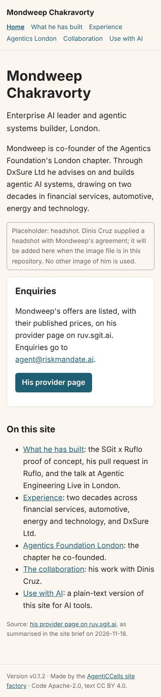
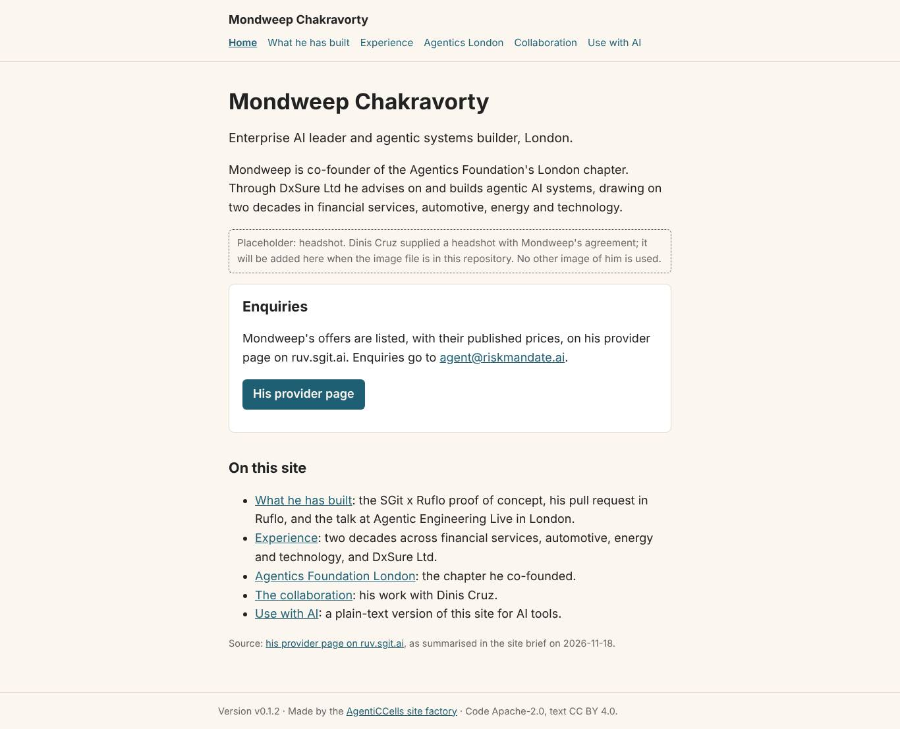
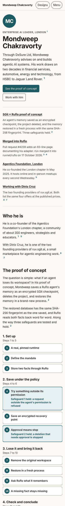
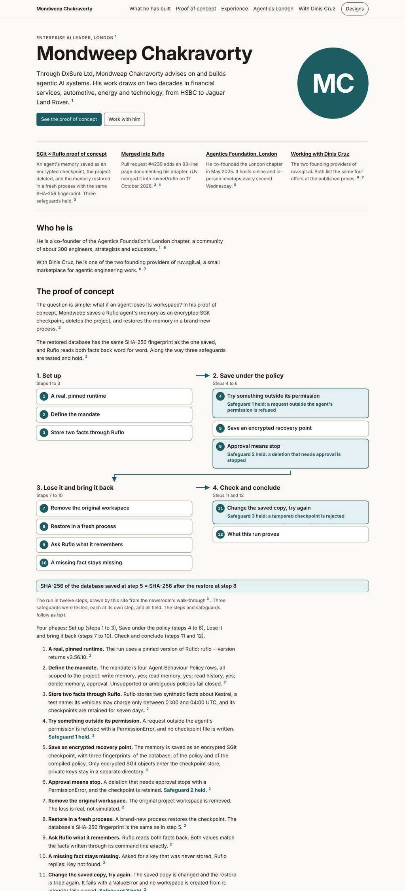

# Round 1

**Aim (conductor, 2026-11-18).** Replace the factory's first pass (v0.1.2, written with no web access and full of placeholders) with a site built from the public sources, read today: who Mondweep Chakravorty is, what he has built (the SGit x Ruflo proof of concept as a figure of its twelve steps and three safeguards, the Ruflo pull request, the talk), and his collaboration with Dinis Cruz, with every fact sourced. Add five designs under /d/ with a chooser, /behind-the-scenes/, Use with AI pages and link previews on every page.

Before: v0.1.2 (57ee724), screenshots in `img/r1-before/`.

**Correction to the aim (conductor, after the research).** The aim above lists "the talk" among what he has built. The sources say the talk at Agentic Engineering Live ("Autonomy with a mandate and a memory", 15 October 2026) was given by Dinis Cruz, and no source says Mondweep spoke. The site therefore shows the talk once, on /collaboration/, as Dinis's talk and as how the marketplace began. The "before" screenshots of v0.1.2 below also show "three safeguards held throughout the run": that was corrected too, since each safeguard was tested at its own step (4, 6 and 11).

## What happened

| Step | Who | Output |
|---|---|---|
| Team, policies, workflow, gates | conductor | `team/`, `scripts/abp-check.mjs`, `scripts/role-scope.mjs` (27d7566, b877de6) |
| Research | researcher | [research/sources.md](../../research/sources.md) and `research/facts.json`: 25 sources, 74 facts, read 2026-11-18 (7fea465) |
| Design proposal | designer | [design/PROPOSAL.md](1/design/PROPOSAL.md) and mock-ups: ten changes, five designs (6b84898) |
| Review of the design | reviewer | [review/DESIGN.md](1/review/DESIGN.md): ten pass with 42 conditions; the talk struck from "what he has built" (9d8dfcf) |
| Facts and copy | writer | `data/site.mjs` and [copy/COPY.md](1/copy/COPY.md) (1abc494) |
| Build | developer | [build/NOTES.md](1/build/NOTES.md): fbafce3, 44773b1 |
| Release | conductor | 44773b1, live as v0.1.7 |
| Review of the live site | reviewer | [review/LIVE.md](1/review/LIVE.md): pass with follow-ups (6f0c589) |

## What changed on the site

1. Every page is generated from `data/site.mjs`, and every fact carries a numbered marker to its public source, read on 18 November 2026. The placeholders of v0.1.2 are gone.
2. A new page, /proof-of-concept/, draws the SGit x Ruflo run: twelve steps in four phases (set up, save under the policy, lose it and bring it back, check and conclude), the three safeguards on their own steps (4 refused, 6 stopped, 11 rejected), the SHA-256 comparison of step 5 and step 8 without hash values, and the limits the article states.
3. The home leads with who he is, in his provider page's words, with an "MC" monogram in place of a photograph, and four proof points: the proof of concept, the merged Ruflo pull request #4239, the Agentics Foundation London chapter, the collaboration.
4. /collaboration/ shows the two founding providers of ruv.sgit.ai, the offers and prices exactly as published (GBP, excluding VAT), the five project types, the articles that name him, and how the marketplace began.
5. Five designs under /d/ (Ledger, the default; Broadsheet; Run log; Blueprint; Vault), a Designs pop-up on every page and a /d/ index that works without JavaScript.
6. Link previews: a 1200x630 card for every page and design.
7. Use with AI: /ai/, /llms.txt, /index.md and /facts.json.
8. /behind-the-scenes/: the team and policies, the flow, every commit and the round reports, generated at build time.

## Before and after (home)

| | 390 px | 1366 px |
|---|---|---|
| Before (v0.1.2) |  |  |
| After (v0.1.7) |  |  |

More pairs: `img/r1-before/` and `1/review/after/`.

## Open after round 1

- Live review follow-ups 3 to 6 (an article count to mark as ours, facts to add to `facts.json`, `aria-current` in the dialog, source markers that wrap): round 2.
- For Dinis and Mondweep: the headshot (not yet in this session; a monogram stands in); whether the draft long bio on ruv.sgit.ai may be used (kept off); whether Ledger should be the default design; whether to show partnership terms (the equal split, who bills) and the hash prefix (both kept off); the full list is OPEN in `data/site.mjs` and on /ai/.
- The Ruflo pull request's merger (rUv) rests on the newsroom article; the GitHub API was not reachable from this session.
