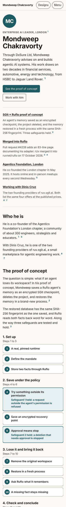
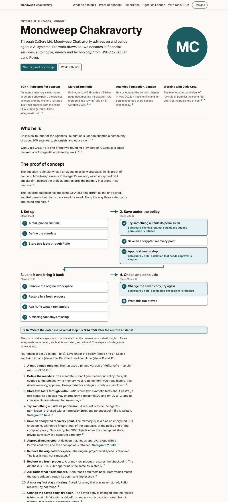
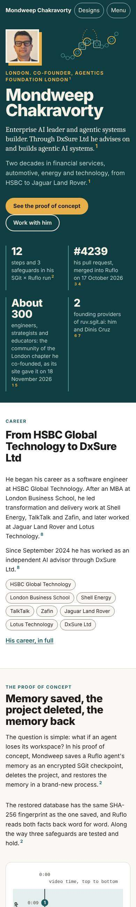
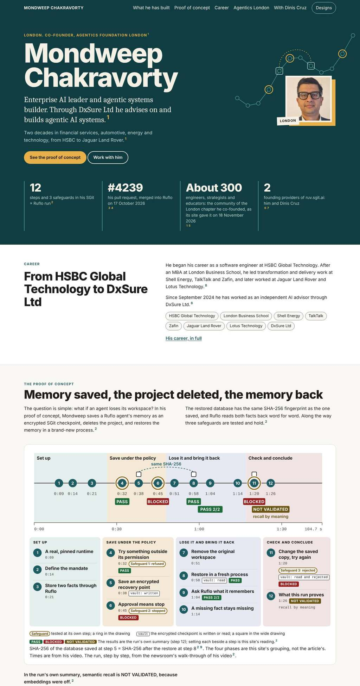

# Round 2

**Aim (conductor, 2026-11-18).** Round 1 put the facts in place. Round 2 makes the site easier to act on and each design more its own: close the live review's follow-ups (3 to 6), give every fact the site prints a quote in `research/facts.json`, make the four other designs show the run in their own way rather than restyle the same page, make "work with him" and the collaboration clearer for an enterprise reader, and add a short "how this was made" note to behind the scenes.

**Widened (conductor, about 10:55 UTC).** Dinis: "Can you make it look and good and creative as the other ACC sites?" Round 2 now also lifts the visual quality of the home and every design to the level of the other AgentiCCells sites: a strong first screen with his headshot (supplied by Dinis at about 10:46 UTC), confident type and colour, the proof of concept drawn as the centrepiece, and designs that each feel made, not restyled. The long bio from ruv.sgit.ai is cleared (about 10:50 UTC) for a proper career page.

Before: v0.1.8 (a9e6a0e); screenshots in `1/review/after/` (taken on v0.1.7, the same pages).

## What happened

| Step | Who | Output |
|---|---|---|
| Headshot and Dinis's words recorded | conductor | `src/assets/photo/mondweep-chakravorty.png`, `team/WORKFLOW.md` (7dafb42, 63ab22e, 214b0d6) |
| Research: a quote for every detail printed; long bio cleared | researcher | `research/facts.json` F94 to F145, [research/GAPS.md](2/research/GAPS.md) (b7993a5, edb2b3c) |
| Design proposal, then a revised Vault | designer | [design/PROPOSAL.md](2/design/PROPOSAL.md) and HTML mock-ups (1655806, 8df07b0) |
| Review of the design | reviewer | [review/DESIGN.md](2/review/DESIGN.md): ten pass with 35 conditions; one heading rejected; Vault sent back once (744b40e, e32f9ef) |
| Copy | writer | `data/site.mjs`, [copy/COPY.md](2/copy/COPY.md) (fe7cb56, 3ea3c5d) |
| Build | developer | [build/NOTES.md](2/build/NOTES.md): eced593, 6bacdd6 |
| Release | conductor | 3ea3c5d, live as v0.1.16 |
| Review of the live site | reviewer | [review/LIVE.md](2/review/LIVE.md): pass with three fixes (ed006d8) |
| Fixes | conductor, developer | 8bfd33c (team files name no other person), ac3ec25 and 6359fe4, live as v0.1.18 |

## What changed on the site

1. The home opens on a teal field with his headshot (supplied by Dinis), his name in large type, a drawn motif from the run and four sourced numbers: 12 steps and 3 safeguards, pull request #4239, a community of about 300, two founding providers.
2. The run is drawn on his video's 0 to 104.7 second scale, with the four phases, the safeguards at steps 4, 6 and 11, the SHA-256 comparison of steps 5 and 8, and the run's own results, placed on steps as the site's reading (said in the key).
3. A career page, "From HSBC Global Technology to DxSure Ltd", from the long bio on ruv.sgit.ai that Dinis cleared (facts F09 to F12 and F14; F13 and F15 stay off and the build refuses them).
4. "Work with him": the five kinds of project, the four offers at their published prices, how to enquire; and a 16 to 21 October strip on /collaboration/.
5. Broadsheet (a front page with a plate of the steps), Run log (the story beside the run's log, with video times), Blueprint (one drawn sheet with zones and safeguard balloons) and Vault (the run as one vault door: twelve steps on a dial, the policy gate as a ring, the vault at the centre) each open on a first screen of their own.
6. The designs pop-up shows large previews; each design's link preview shows its own first screen.
7. Behind the scenes adds "The team behind this site".
8. The build's checks follow Dinis's words: the image check allows exactly the supplied headshot (pinned by SHA-256) and the images made from it, and refuses any other image of him; the approval check refuses F13 and F15 and requires the long bio to cite its source; the people check now also refuses the names of the people behind two earlier AgentiCCells sites.

## Before and after (home)

| | 390 px | 1366 px |
|---|---|---|
| Before (v0.1.7) |  |  |
| After (v0.1.16) |  |  |

More: `2/review/after/` (proof of concept, career, collaboration and the four designs).

## Open after round 2

- The reviewer judges round 2 largely meets Dinis's aim; the career page, /collaboration/ and further polish of the designs are the next round's work if Dinis wants one.
- Conductor's decision, for Dinis to reverse: screenshots of the live site in the round reports show the supplied headshot as it appears on the site; each round page says so.
- For Dinis and Mondweep: whether Ledger stays the default design; whether to show partnership terms (equal split, who bills) and the hash prefix (both kept off); the other questions in OPEN in `data/site.mjs` and on /ai/. Mondweep has not yet reviewed the site.
